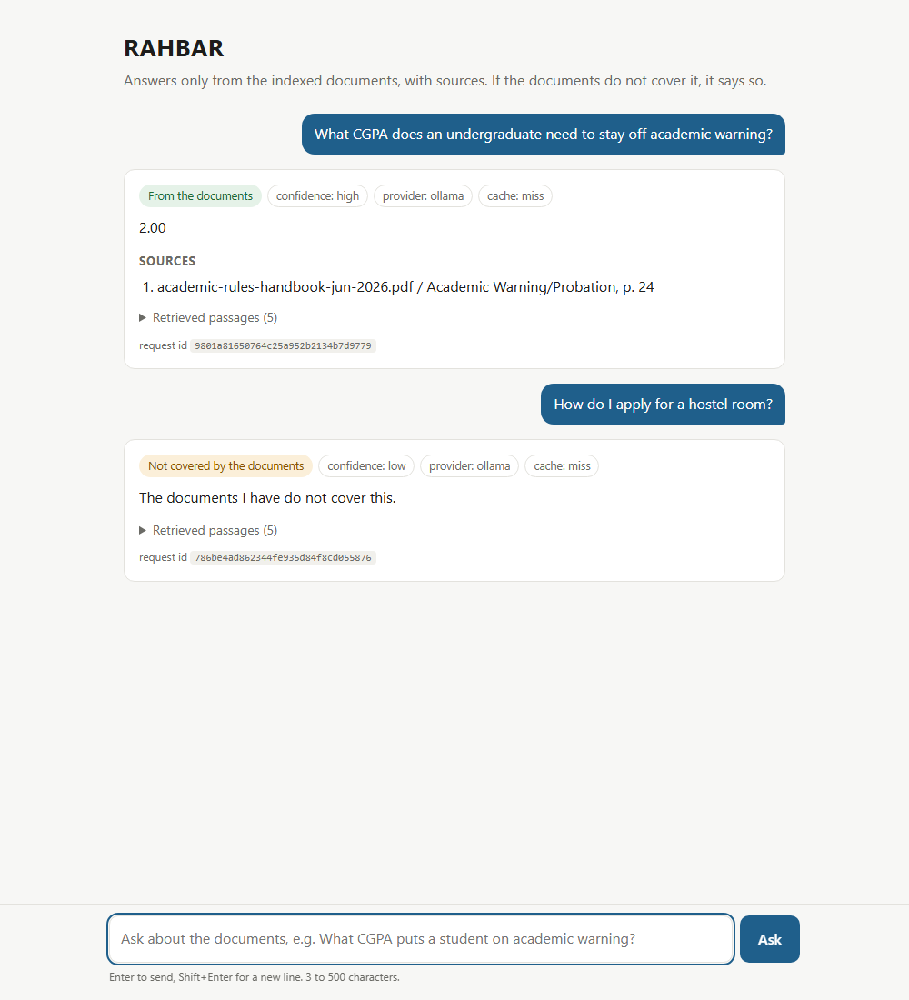
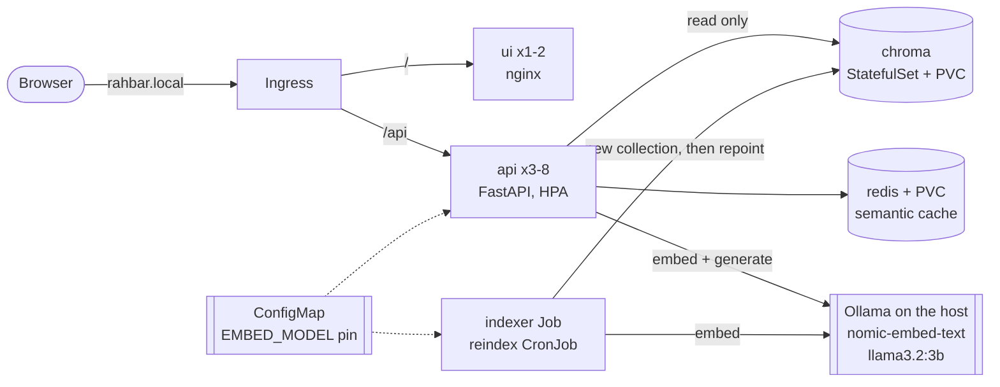

# RAHBAR

[](https://github.com/T-Urfan/RAHBAR-24i-3083/actions/workflows/ci.yml)
[](https://github.com/T-Urfan/RAHBAR-24i-3083/actions/workflows/cd.yml)

A FAST-NUCES student wants to know whether they can withdraw from a course in the last week
of the semester. The answer is in clause 4.25 of a PDF on the university website, and an
older version of that PDF, with a different deadline, is still online too. A general chatbot
answers confidently from some other university's rules. **RAHBAR answers only from the
university's own documents, cites the section it used, prefers the current version over the
superseded one, and says "the documents I have do not cover this" when they don't.** It runs
on Kubernetes: an indexer Job writes the vector store, three API replicas read it, and a CI
gate fails the build when retrieval quality drops.

CS4032 Software Construction & Development, Assignment 02. Solo project.



## Architecture



The design in one sentence: **indexing runs once, and again when the documents change;
querying runs on every question**, so they are different workloads ([ADR 0001](docs/adr/0001-indexer-as-job.md)).
More in [docs/ARCHITECTURE.md](docs/ARCHITECTURE.md).

## Measured results

From `eval/results.json` (21 golden questions over 9 documents, 279 PDF pages, 41 of them
OCR'd; llama3.2:3b on a laptop CPU):

| recall@3 | recall@5 | citation validity | must-abstain declined | answerable answered | fallbacks |
| --- | --- | --- | --- | --- | --- |
| 0.971 | 0.971 | 100% | 4 of 4 (and 10 of 10 probes) | 16 of 17 (q09 declined, not answered wrongly) | 0 |

How the numbers were chosen (chunk size, relevance floor, cache threshold, the confidence
gate) is in [docs/PIPELINE.md](docs/PIPELINE.md); what breaks when each stage is broken on
purpose is in [docs/FAILURE-ANALYSIS.md](docs/FAILURE-ANALYSIS.md).

## API

| Method | Path | Purpose |
| --- | --- | --- |
| POST | `/api/ask` | `{"question": "..."}` (3-500 chars) → answer, citations, `answered_from_context`, confidence, retrieved passages with scores, `cached`. Echoes `X-Request-ID`; sends `X-Cache: HIT/MISS`. |
| GET | `/healthz` | Liveness: the process is alive. Touches nothing else. |
| GET | `/readyz` | Readiness: Chroma reachable, live collection non-empty, embedding model matches the index, Redis reachable. 503 names each failure. |
| GET | `/metrics` | Prometheus: requests and latency by route, retrieval/embedding/generation latency, cache hit ratio, abstentions, fallbacks, retries, tokens in/out, questions in flight. |

```console
$ curl -s -X POST http://127.0.0.1/api/ask -H "Host: rahbar.local" \
    -H "Content-Type: application/json" \
    -d '{"question": "What is the deadline to withdraw from a course?"}'
{"answer": "Last day of the makeup week of every semester",
 "citations": [{"source": "academic-rules-handbook-jun-2026.pdf",
                "section": "Withdrawal from a Course", "page": 22}],
 "answered_from_context": true, "confidence": "high", "cached": false, ...}
```

## From a clean clone to an answered question (minikube)

Requirements: Docker, minikube, kubectl, Python 3.12, and
[Ollama](https://ollama.com) on the host. About 6 GB of RAM for minikube plus about 3 GB
for the model.

**1. Ollama on the host**, listening on all interfaces so the cluster can reach it:

```powershell
$env:OLLAMA_HOST = "0.0.0.0"; ollama serve          # Windows PowerShell
# OLLAMA_HOST=0.0.0.0 ollama serve                   # Linux / macOS
ollama pull nomic-embed-text
ollama pull llama3.2:3b
```

**2. A cluster with a CNI that enforces NetworkPolicy** (Calico), plus metrics and ingress:

```bash
minikube start --driver=docker --cni=calico --memory=6144 --cpus=4
minikube addons enable metrics-server
minikube addons enable ingress
```

**3. Build the three images and load them into minikube** (tag `dev`, as the dev overlay expects):

```bash
docker build -t rahbar-api:dev api
docker build -t rahbar-ui:dev ui
docker build -f indexer/Dockerfile -t rahbar-indexer:dev .     # build context: repo root
minikube image load rahbar-api:dev
minikube image load rahbar-ui:dev
minikube image load rahbar-indexer:dev
```

**4. Apply, in this order.** One command applies everything; the namespace and ConfigMap
come first in `k8s/base/kustomization.yaml`:

```bash
kubectl apply -k k8s/overlays/dev
```

The Secret is only needed for `LLM_PROVIDER=hosted`. Create it from the command line, never
from a file (`k8s/base/secret.placeholder.yaml` is a placeholder and is not applied):

```bash
kubectl create secret generic rahbar-secret -n rahbar --from-literal=LLM_API_KEY="$LLM_API_KEY"
```

**5. Wait for the data tier, then the indexer Job.** The Job's init container fetches the
nine public documents listed in `corpus/sources.yaml` onto the `corpus` PVC (one request at a
time, a 2 s pause, files already present are reused), then indexes them. The api pods stay
`0/1 READY` until the index exists. That is the readiness probe working.

```bash
kubectl -n rahbar rollout status statefulset/chroma
kubectl -n rahbar rollout status deployment/redis
kubectl -n rahbar wait --for=condition=complete job/indexer --timeout=30m
kubectl -n rahbar logs job/indexer -c indexer | tail -3      # "index activated", 501 chunks
kubectl -n rahbar rollout status deployment/api
```

**6. Ask through the Ingress.** With the docker driver on Windows or macOS the minikube IP is
not reachable from the host, so run `minikube tunnel` in another terminal and use 127.0.0.1;
on Linux use `$(minikube ip)`.

```bash
curl -s -X POST http://127.0.0.1/api/ask -H "Host: rahbar.local" \
  -H "Content-Type: application/json" \
  -d '{"question": "What CGPA puts a student on academic warning?"}'
curl -s -X POST http://127.0.0.1/api/ask -H "Host: rahbar.local" \
  -H "Content-Type: application/json" \
  -d '{"question": "How do I apply for a hostel room?"}'          # declines
```

For the chat page add `127.0.0.1 rahbar.local` to your hosts file and open http://rahbar.local/.

**7. Delete a pod; nothing breaks.**

```bash
kubectl -n rahbar delete pod -l app.kubernetes.io/name=api --wait=false
kubectl -n rahbar get endpoints api            # the Service keeps at least 2 ready IPs
kubectl -n rahbar delete pod chroma-0          # comes back as chroma-0 on the same PVC
```

### Re-index without a redeploy

```bash
kubectl create job --from=cronjob/reindex manual-reindex-1 -n rahbar
```

The new index goes live only after it is verified; the semantic cache follows automatically.
To roll back to the previous index (the label lets the NetworkPolicy admit it to Chroma):

```bash
kubectl -n rahbar run rollback --rm -it --restart=Never --image=rahbar-indexer:dev \
  --labels=app.kubernetes.io/name=indexer --env=CHROMA_HOST=chroma -- --rollback
```

## Run it without a cluster

```bash
python -m venv .venv && .venv/bin/pip install -r api/requirements-dev.txt -r indexer/requirements-dev.txt
cd api && SERVE_UI_DIR=../ui RETRIEVER=stub LLM_PROVIDER=stub ../.venv/bin/uvicorn app.main:app --port 8000
```

On Windows, `scripts/dev.ps1` has the same targets as the Makefile (`install`, `test`, `lint`,
`dev`, `check`). `make` lists them on Linux/macOS.

## Tests and CI

```bash
cd api && pytest -q --cov=app          # 139 tests, 98% coverage, stub provider, no network
cd indexer && pytest -q                # 128 tests; the real-OCR one needs tesseract on PATH
pytest -q eval                         # 11 tests of the evaluation functions
python eval/run_eval.py --api http://127.0.0.1 --host rahbar.local   # the section 5.4 gate
python scripts/check_submission.py
```

`.github/workflows/ci.yml` (pull requests to `main`, pushes to `dev`): ruff and mypy, pytest
with a 60% coverage gate (no system packages needed), **ocr**: the real scanned-PDF OCR test
with Tesseract 5.5 from conda-forge, `kustomize build | kubeconform -strict` on every
overlay, image builds (checking `tesseract` inside the indexer image), Trivy (fails on
fixable HIGH/CRITICAL), and **e2e-eval**: a kind cluster, the manifests, the indexer Job on
the fixture corpus, then `eval/run_eval.py` through the Ingress with the gate. `cd.yml` (push to `main`): test → build-push to Docker Hub tagged with
the commit SHA → deploy to an ephemeral cluster, `kubectl rollout status`, smoke test.
`main` is protected: pull request, passing CI and one approval required.

## The corpus

Public FAST-NUCES documents, not committed: `corpus/MANIFEST.md` lists each URL with its
SHA-256, and `corpus/fetch.py` downloads them (`python corpus/fetch.py`, then `--verify`).
It has two versions of the academic rules (Aug 2023, superseded; Jun 2026), a scanned PDF,
fee and grade tables, long definitions, exact clause numbers and fees, and one topic left
out on purpose: hostels. See [docs/CORPUS.md](docs/CORPUS.md).

## Generation and embedding

`LLM_PROVIDER=ollama-host`: generation **and** embeddings go to Ollama on the host
(`host.minikube.internal:11434`). The embedding model is pinned separately by `EMBED_MODEL`
in the one ConfigMap both the indexer and the api read, and the api refuses to become ready
if the index was built with another model ([ADR 0004](docs/adr/0004-llm-provider-and-data-governance.md)).

## Known limitations

- The evaluation numbers above were measured on the development laptop against native
  Chroma, Redis and Ollama processes with llama3.2:3b. CI's e2e job uses the same images on
  kind with real embeddings but the **stub** LLM, so it checks retrieval, abstention and
  citations, not real generation.
- Local minikube could not run on the development machine (a pre-release Windows build on
  which WSL cannot create a VM: ENGINEERING-NOTES.md, question 7). Cluster evidence comes
  from kind in GitHub Actions.
- A 3B model on CPU: 8-20 s per answer, and q09 is unstable (declined in the final run,
  answered wrongly at confidence high in others).
- The semantic cache (threshold 0.95) serves repeats and rewordings, not paraphrases.
- The CPU-based HPA is the wrong signal for an I/O-bound generation service
  (ENGINEERING-NOTES.md, question 3).

## Documents

| | |
| --- | --- |
| [ARCHITECTURE.md](docs/ARCHITECTURE.md) | objects, request path, why Chroma is a StatefulSet |
| [CORPUS.md](docs/CORPUS.md) | the seven required properties and the traps in the files |
| [PIPELINE.md](docs/PIPELINE.md) | extraction, cleaning, chunking table, embedding, cache threshold, evaluation |
| [FAILURE-ANALYSIS.md](docs/FAILURE-ANALYSIS.md) | five stages broken on purpose |
| [ENGINEERING-NOTES.md](docs/ENGINEERING-NOTES.md) | the seven questions |
| [docs/adr/](docs/adr/) | indexer as a Job, chunking, Redis cache, provider and data governance |
| [AI-USAGE.md](docs/AI-USAGE.md) | what AI wrote, and what was changed |
| [VIVA-GUIDE.md](docs/VIVA-GUIDE.md) | how every part works, and the questions to expect |
| [WORKLOG.md](docs/WORKLOG.md) | what was done, with the commands and results |
