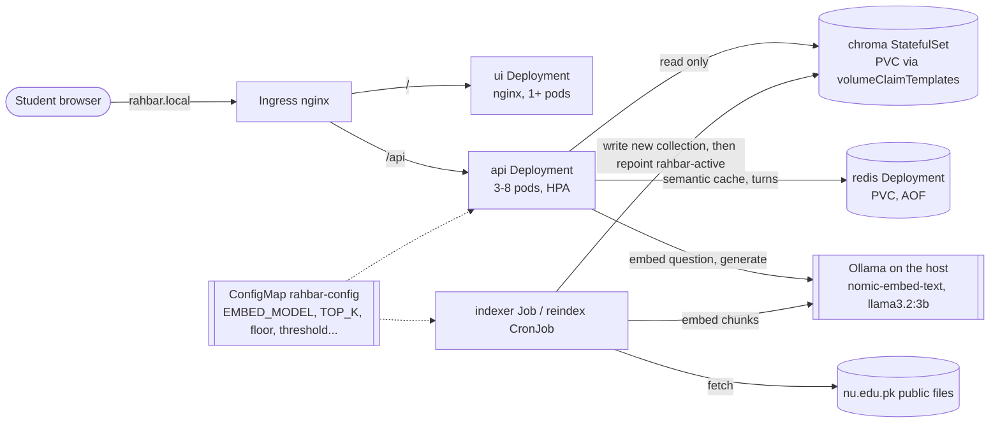

# Architecture

RAHBAR has two paths that never share a process: an **indexer** that writes the vector
store when the documents change, and an **API** that only reads it on every question. One
ConfigMap gives both the same `EMBED_MODEL`.

## The objects (namespace `rahbar`)

| Object | File | Why it is shaped this way |
| --- | --- | --- |
| Namespace `rahbar` | `k8s/base/namespace.yaml` | nothing in `default` |
| Deployment `api` x3 | `k8s/base/api.yaml` | stateless reader; startup, liveness (`/healthz`) and readiness (`/readyz`) probes; `maxSurge: 1`, `maxUnavailable: 0`, `preStop` sleep 10 s, grace 45 s |
| HPA `api` 3-8 | `k8s/base/api.yaml` | `autoscaling/v2`, CPU 70% of a 100m request |
| PDB `api` | `k8s/base/api.yaml` | at least 2 pods survive a node drain |
| Deployment `ui` | `k8s/base/ui.yaml` | nginx-unprivileged on 8080, `/tmp` emptyDir |
| StatefulSet `chroma` | `k8s/base/chroma.yaml` | see below |
| Deployment `redis` + PVC | `k8s/base/redis.yaml` | `Recreate`: a ReadWriteOnce volume takes one pod at a time |
| Job `indexer` | `k8s/base/indexer.yaml` | `restartPolicy: OnFailure`, `backoffLimit: 2` (ADR 0001) |
| CronJob `reindex` | `k8s/base/indexer.yaml` | weekly, same image and arguments, `concurrencyPolicy: Forbid` |
| PVC `corpus` | `k8s/base/indexer.yaml` | fetched documents survive between runs, so each is downloaded once |
| Services x4 | each file | all ClusterIP; only the Ingress is reachable from outside |
| Ingress | `k8s/base/ingress.yaml` | `/` to ui, `/api` to api, host `rahbar.local` |
| ConfigMap | `k8s/base/configmap.yaml` | every tunable, read by both api and indexer |
| Secret | created on the command line | `LLM_API_KEY` for `hosted` only; `secret.placeholder.yaml` is never applied |
| NetworkPolicies | `k8s/base/networkpolicy.yaml` | deny by default, then only the arrows in the diagram |
| ServiceAccounts x5 | `k8s/base/serviceaccounts.yaml` | one per workload, no token mounted |

## Why Chroma is a StatefulSet, not a Deployment

Chroma keeps the index on disk. A Deployment treats its pods as interchangeable and
replaceable:

- a rolling update starts the new pod **before** the old one stops, so for a moment two
  Chroma processes would open the same ReadWriteOnce volume (on a single node the mount
  succeeds, and two SQLite writers corrupt the index), or the new pod hangs waiting for
  the volume;
- a Deployment's pods share one PVC that has to be created separately, and nothing ties
  "the pod" to "its data".

A StatefulSet gives the pod a stable name (`chroma-0`) and, through `volumeClaimTemplates`,
its own PVC (`data-chroma-0`) that follows it: deleting the pod brings back `chroma-0` on
the same volume with the same index. It replaces pods one at a time, stopping the old one
first. Redis also holds data, but it is a cache: a Deployment with `strategy: Recreate`
and one PVC is enough, and losing it loses only speed.

## Request path, step by step

`api/app/services/answer.py` runs the eight steps of section 3.2:

1. **Validate** (Pydantic, 3 to 500 characters; otherwise 422).
2. **Embed** the question: `search_query: ` + the indexer's own normalisation, through
   the pinned model (`services/embedding.py`). One retry, then the fallback.
3. **Cache check** in Redis, skipped for follow-ups (`services/cache.py`).
4. **Retrieve** top `TOP_K` from the live collection named by `rahbar-active`, with
   `superseded: false` unless the question asks about an older version
   (`services/versioning.py`). A question naming a clause also fetches the chunks that
   contain it (`retrieval/chroma.py`).
5. **Relevance floor**: if no passage reaches `RELEVANCE_FLOOR`, abstain now.
6. **Augment and generate**: instructions, numbered and delimited evidence, the question
   (`services/prompt.py`); `format=` the Answer schema (`providers/llm/ollama.py`).
7. **Validate**: Pydantic, then every citation against the passages sent
   (`services/citations.py`); retry once, then a canned fallback. Never a 500.
8. **Store** the turn, and a cache entry only when it is safe to cache.

One JSON log line per request records `top_k`, chunk ids, scores, cache result,
abstention reason, fallback reason, attempts and timings.

## Index life cycle

`indexer/pipeline/run.py`: discover → extract (pdfplumber + pdfium; Tesseract for pages with
no text layer) → clean → chunk → embed (batches of 16) → store into a **new** collection →
verify the count → repoint `rahbar-active` → keep the previous index for `--rollback`. A
failure before the repoint deletes only the unfinished collection; after it, nothing is
deleted. The API notices the new index within `POINTER_TTL_SECONDS` (10 s), and the cache
key space changes with it.

## Where it runs in this project

- **Local development (Windows 11, 16 GB, CPU only):** Ollama, a Chroma 1.0.12 server,
  Redis and the API as native processes, so the real corpus could be indexed and
  evaluated (all numbers in PIPELINE.md come from this).
- **Kubernetes:** the same images on kind clusters in GitHub Actions (`ci.yml` e2e-eval,
  `cd.yml` deploy), and minikube with the `dev` overlay on a machine that can run it (see
  README, "Run it on minikube"; ENGINEERING-NOTES.md question 7 explains why this laptop
  could not).
